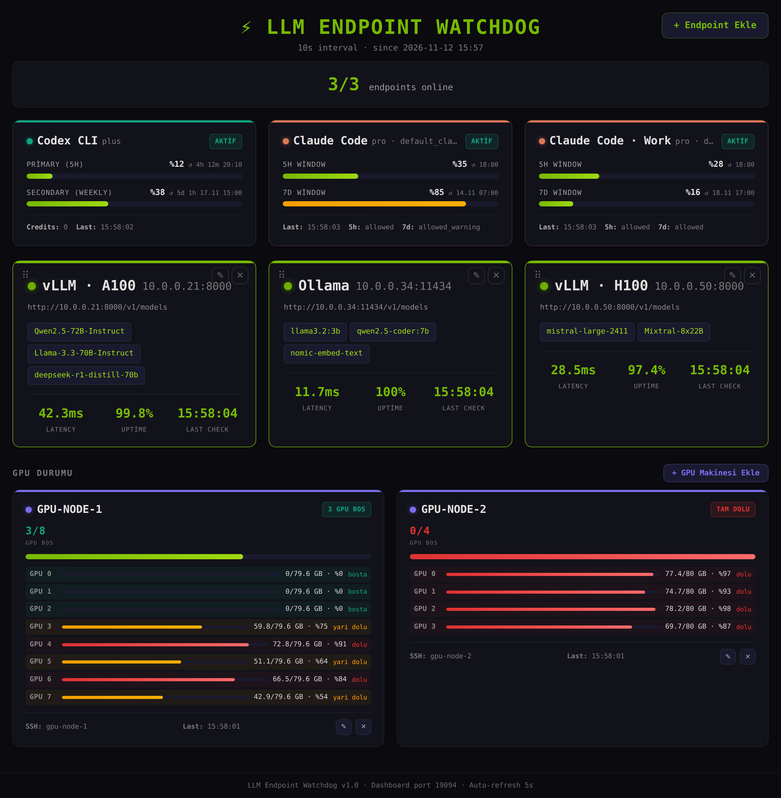

# ⚡ LLM Endpoint Watchdog

OpenAI uyumlu LLM endpointlerini izleyen, hafif ve gerçek zamanlı bir web paneli. Her endpoint'in `/v1/models` adresini kontrol eder; erişilebilirlik, model listesi, yanıt süresi ve uptime bilgisini gösterir. vLLM, Ollama, LocalAI ve aynı API biçimini sunan diğer servislerle kullanılabilir.

Harici Python paketi gerektirmez. Tek dosya, tek komut.



## Neler yapar

- **Endpoint izleme** — her `host:port` için `/v1/models` kontrolü, model listesi, yanıt süresi ve uptime.
- **Codex / Claude kullanımı** — kurulumda hiçbir ayar istemez. Codex CLI ve Claude Code profillerini sistemde kendisi bulur (`$CODEX_HOME`, `~/.codex`, `$CLAUDE_CONFIG_DIR`, `~/.claude`, `~/.claude-*`) ve 5 saatlik / haftalık kota kullanımını kart olarak gösterir. Bulunamayan profil hiç görünmez.
- **GPU izleme** — panelden eklediğiniz makinelerde SSH ile `nvidia-smi` çalıştırır, boş/dolu GPU sayısını gösterir.
- **Sıfır yapılandırma** — tüm yerel ayarlar `watchdog_endpoints.json` dosyasında tutulur ve Git tarafından takip edilmez.

## Çalıştırma

Gereksinim: Python 3.9 veya daha yeni bir sürüm.

```bash
git clone https://github.com/KULLANICI/llm-endpoint-watchdog.git
cd llm-endpoint-watchdog
python3 llm-endpoint-watchdog.py
```

`KULLANICI` kısmını reponun GitHub kullanıcı adı ile değiştirin; GitHub'daki **Code** düğmesi hazır URL'yi verir.

Ardından tarayıcıda [http://localhost:9090](http://localhost:9090) adresini açın.

Panel ilk açılışta `127.0.0.1:8000` adresini izler. Başka bir OpenAI uyumlu LLM servisi eklemek için paneldeki alana `sunucu-ip:port` biçiminde adres girin:

```text
10.0.0.5:8000
```

## 7/24 çalıştırma (systemd)

Paneli terminalden bağımsız çalıştırmak ve makine her açıldığında kendiliğinden başlatmak için systemd servisi kullanın. Aşağıdaki örnekte servis adı `llmwatchdog`, proje yolu `~/llm-endpoint-watchdog` olarak alınmıştır; farklı bir dizin kullanıyorsanız yolları ona göre değiştirin.

Gereksinim Python 3.9 veya daha yenisi. Yolu doğrulayın:

```bash
which python3
python3 --version
```

### Servis dosyası

`/etc/systemd/system/llmwatchdog.service` dosyasını `sudo` ile oluşturun:

```ini
[Unit]
Description=LLM Endpoint Watchdog
After=network-online.target
Wants=network-online.target

[Service]
Type=simple
User=KULLANICI
Group=KULLANICI
ExecStart=/usr/bin/python3 /home/KULLANICI/llm-endpoint-watchdog/llm-endpoint-watchdog.py
Restart=always
RestartSec=5
StandardOutput=journal
StandardError=journal
SyslogIdentifier=llmwatchdog

# İsteğe bağlı kaynak sınırları
MemoryMax=128M
CPUQuota=10%

[Install]
WantedBy=multi-user.target
```

Değiştirmeniz gereken üç yer:

- `KULLANICI` → kendi kullanıcı adınız (`whoami`).
- `ExecStart` içindeki `/usr/bin/python3` → `which python3` çıktınız.
- Proje başka bir dizindeyse `ExecStart` yolunu güncelleyin.

Servis `User=` ile sizin kullanıcınız olarak çalıştığı için Codex/Claude profillerini (`~/.codex`, `~/.claude*`), SSH anahtarlarınızı (`~/.ssh`) ve `watchdog_endpoints.json` dosyasını sorunsuz bulur. `HOME` systemd tarafından otomatik ayarlandığı için ek `Environment=` satırı gerekmez.

### Etkinleştirme

```bash
sudo systemctl daemon-reload
sudo systemctl enable --now llmwatchdog
```

Servisin ayakta olduğunu doğrulayın:

```bash
systemctl status llmwatchdog --no-pager
journalctl -u llmwatchdog -n 20 --no-pager
curl -s -o /dev/null -w "%{http_code}\n" http://localhost:9090
```

Son komut `200` dönerse panel yayındadır: [http://localhost:9090](http://localhost:9090). `Restart=always` sayesinde süreç beklenmedik şekilde kapanırsa 5 saniye sonra yeniden başlar.

### Yönetim komutları

| İşlem | Komut |
|-------|-------|
| Durum | `systemctl status llmwatchdog` |
| Canlı log | `journalctl -u llmwatchdog -f` |
| Yeniden başlat | `sudo systemctl restart llmwatchdog` |
| Durdur | `sudo systemctl stop llmwatchdog` |
| Açılıştan kaldır | `sudo systemctl disable --now llmwatchdog` |

### Güncelleme ve ayarlar

- **Kod güncellemesi:** `git pull` sonrası `sudo systemctl restart llmwatchdog`.
- **Ayar değişikliği:** `CHECK_INTERVAL`, `DASHBOARD_PORT` ve `TIMEOUT` sabitlerini düzenledikten sonra servisi yeniden başlatın. Panelin adresi de `DASHBOARD_PORT` ile birlikte değişir.
- **Port çakışması:** `ss -ltnp | grep 9090` ile portu hangi sürecin dinlediğine bakın.
- Panel `0.0.0.0` üzerinde dinlediği için ağdaki diğer makinelerden de açılır. Yalnızca yerel erişim istiyorsanız güvenlik duvarında 9090 portunu kapatın.
- `watchdog_endpoints.json` dosyasını servis kullanıcısı yazar; proje dizini o kullanıcıya ait ve yazılabilir olmalıdır.

### Root olmadan: kullanıcı servisi

Makinede root erişiminiz yoksa aynı uygulamayı kullanıcı servisi olarak çalıştırabilirsiniz. `~/.config/systemd/user/llmwatchdog.service` dosyasını oluşturun:

```ini
[Unit]
Description=LLM Endpoint Watchdog

[Service]
Type=simple
ExecStart=/usr/bin/python3 %h/llm-endpoint-watchdog/llm-endpoint-watchdog.py
Restart=always
RestartSec=5

[Install]
WantedBy=default.target
```

```bash
systemctl --user daemon-reload
systemctl --user enable --now llmwatchdog
loginctl enable-linger $USER
```

Son satır, oturum açık olmasa da servisin çalışmasını sağlar ve bir kez çalıştırılması yeterlidir. Bu yöntemde log için `journalctl --user -u llmwatchdog -f`, yeniden başlatmak için `systemctl --user restart llmwatchdog` kullanın.

## Codex / Claude kullanımı

Panel, aşağıdaki konumlarda oturum açmış hesapları otomatik olarak bulur:

| Araç | Aranan yer |
|------|------------|
| Codex CLI | `$CODEX_HOME/auth.json`, yoksa `~/.codex/auth.json` |
| Claude Code | `$CLAUDE_CONFIG_DIR`, `~/.claude/.credentials.json`, `~/.claude-*/.credentials.json` |

Ek bir ayar, API anahtarı veya yapılandırma gerekmez; ilgili araçta oturum açmış olmanız yeterlidir. Profiller çalışma sırasında da taranır, yeni bir hesap eklediğinizde panel kendiliğinden gösterir.

## GPU makineleri

Paneldeki **+ GPU Makinesi Ekle** düğmesiyle makine adı girin (ör. `gpu-node`). Makine adı SSH yapılandırmanızda tanımlı olmalıdır; komut yazmanız gerekmez, `nvidia-smi` sorgusu otomatik kurulur. İç içe SSH için `jump-host -> gpu-node` biçiminde yazabilirsiniz.

Eklediğiniz endpointler ve GPU makineleri yerel `watchdog_endpoints.json` dosyasına kaydedilir. Bu dosya Git tarafından takip edilmez.

Uygulamayı durdurmak için terminalde `Ctrl+C` tuşlarına basın.

## Ayarlar

Kontrol aralığı, panel portu ve zaman aşımı `llm-endpoint-watchdog.py` dosyasının başındaki sabitlerden değiştirilebilir:

```python
CHECK_INTERVAL = 10
DASHBOARD_PORT = 9090
TIMEOUT = 5
```
